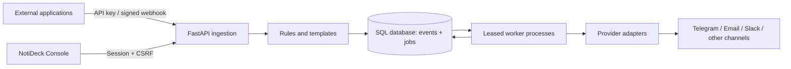
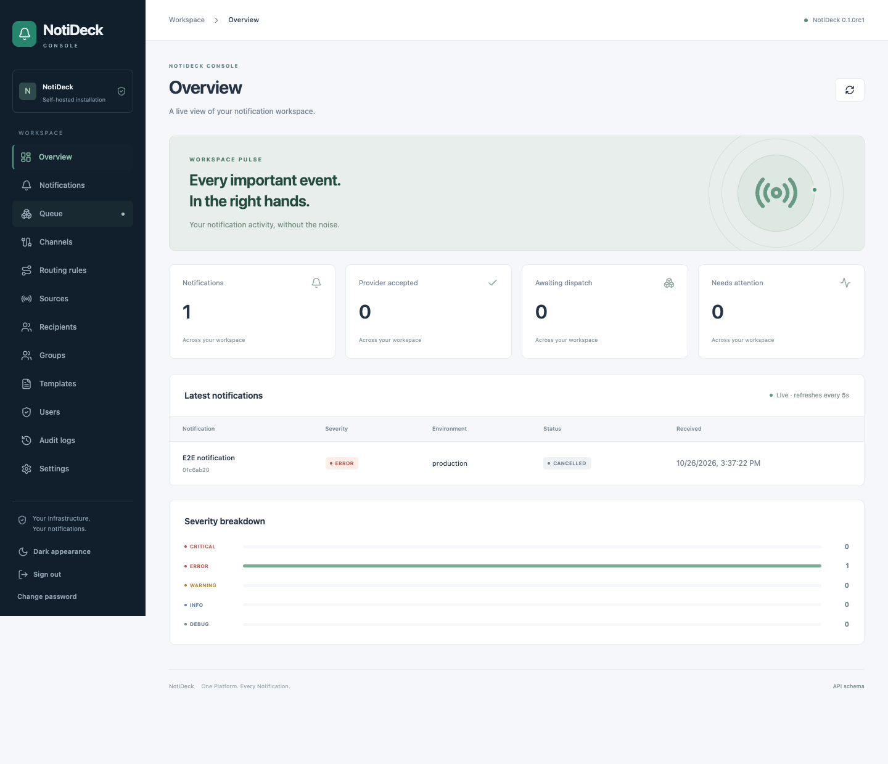

# NotiDeck

**One Platform. Every Notification.**

NotiDeck is a self-hosted notification router with a React administration console,
FastAPI ingestion API, and durable SQL-backed delivery workers. Version **0.1.0rc1** is the production
release candidate for final acceptance testing. See
[implementation status and limitations](docs/limitations.md) before deployment.

[Upgrade to the candidate](docs/upgrade-0.1.0rc1.md) · [Validation results](docs/validation.md) · [Acceptance checklist](IMPLEMENTATION.md)

## What works

- Token-protected setup, SQLite initialization, administrator creation and login.
- Argon2id passwords, expiring cookie sessions, CSRF protection and backend RBAC.
- Sources, scoped/revocable API keys, signed inbound webhooks and idempotent ingestion.
- Ordered rules, severity comparisons, metadata conditions, groups, simulation and templates.
- Encrypted channel configurations and real provider adapters for Telegram, SMTP,
  Slack, Discord, HTTP webhooks, WhatsApp templates, Twilio SMS and a Signal bridge.
- Durable delivery jobs, independent attempt history, leases, retries, throttling,
  dead letters, pause/resume, previewed queue cancellation and audit records.
- Console setup, overview, searchable history, queue, channels, routes, sources,
  recipients, groups, templates, users, audits and settings, with light/dark appearance.
- CLI, bundled frontend assets, Alembic migrations, optional database drivers,
  provider plugins and container/release workflow definitions.



## Install and run

Python 3.11+ is required. No Node.js is needed by wheel users.

```sh
# Install the locally built release (this repository has NOT been published to PyPI):
python -m pip install dist/notideck-0.1.0rc1-py3-none-any.whl
notideck serve
```

Open **http://127.0.0.1:8000**. The terminal shows the private bootstrap token file
path. Read that file locally and paste the token into the setup wizard. Choose a
database, test it, create your administrator and finish setup. No default accounts
or passwords exist. The default SQLite database is stored in the OS application
data directory, not in your current working directory.

After setup, run a worker in a second terminal:

```sh
notideck worker
# Alternatively, restart the local server with its managed child worker:
notideck serve --embedded-worker
```

The intended published installation command is `pip install notideck`; publication
requires a separately authorized release and confirmed PyPI project ownership.

## Send your first notification

1. Create a channel and use **Test** to make a real test send.
2. Create a routing rule with a destination channel. For example,
   `environment equals production` AND `severity gte ERROR`.
3. Register a source and create its API key. Copy the key immediately.
4. Submit an event, then inspect Notifications and Queue.

```sh
export NOTIDECK_API_KEY='replace-with-your-created-key'
curl -X POST http://127.0.0.1:8000/api/v1/notifications \
  -H "Authorization: Bearer $NOTIDECK_API_KEY" \
  -H 'Content-Type: application/json' \
  -d '{"environment":"production","severity":"CRITICAL","title":"Replication lag", "message":"Lag exceeded 120 seconds.","idempotency_key":"replication-123"}'
```

HTTP 202 acknowledges durable persistence, not recipient delivery. `SENT` means
provider acceptance. Delivery is **at least once**; a crash after acceptance may
cause duplicate sends. Queue clearing cancels eligible jobs and preserves history.

## Docker

```sh
docker compose up --build -d web
# Complete setup in the browser, then:
docker compose up -d worker
```

The private bootstrap token is at `/data/bootstrap.token` inside the web container:
`docker compose exec web cat /data/bootstrap.token`. Keep that token private.
A PostgreSQL example is provided in `docker-compose.postgres.yml`.

## Development

```sh
python3.12 -m venv .venv
. .venv/bin/activate
pip install -e '.[dev]'
npm --prefix frontend ci
npm --prefix frontend run build
pytest
npm --prefix frontend test
ruff check src tests
mypy src/notideck
python -m build
```

Dependency ranges live in `pyproject.toml`, the tested Python development snapshot
in `requirements-dev.lock`, and the frontend dependency graph in `frontend/package-lock.json`.
See [development](docs/development.md) for optional live database tests.

## Documentation

[Installation](docs/installation.md) · [Configuration](docs/configuration.md) ·
[API](docs/api.md) · [Channels](docs/channels.md) · [Routing](docs/routing.md) · [Notification templates](docs/notification-templates.md) ·
[Deployment](docs/deployment.md) · [Security](docs/security.md) ·
[Plugin API](docs/plugins.md) · [Release checklist](docs/release.md)

Licensed under Apache-2.0. Contributions are welcome; read [CONTRIBUTING.md](CONTRIBUTING.md).
The screenshot below was generated by the local browser test with synthetic test data.
Live-provider certification is not claimed.


